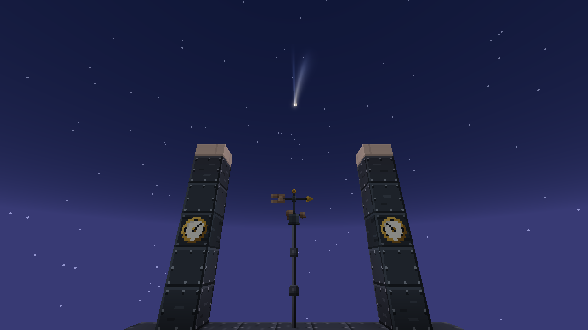
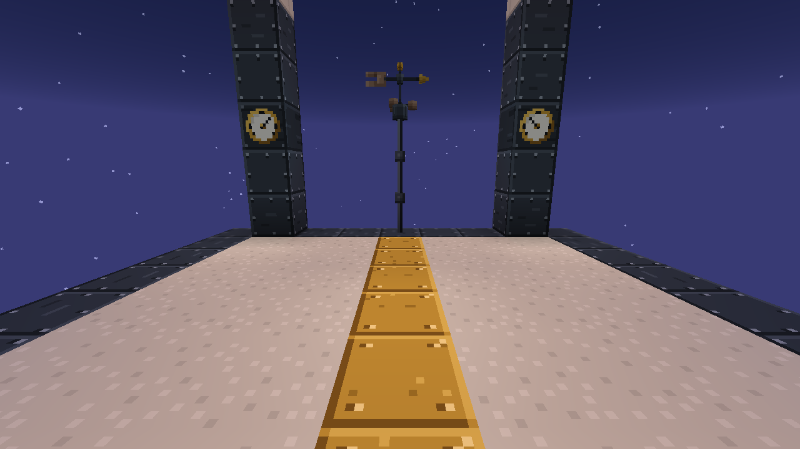
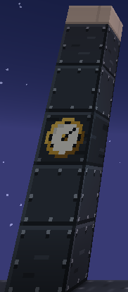
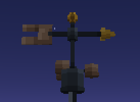
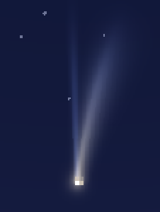
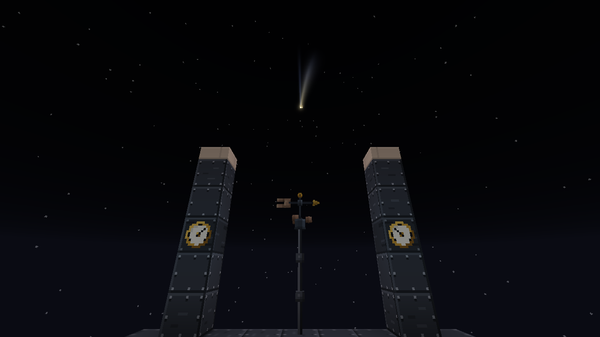

# 试传存档 T1、T2：照着点，十分钟以内

**游戏版本：Minecraft Java 版 26.3（正式版）。** Realms 只跑最新的正式版，今天最新的正式版就是 26.3。启动器里如果最新版已经不是 26.3，先别传，告诉总监。

要你回答的只有两件事：

1. 自己上传的存档，Realms 会不会把存档里带的资源包发给进服的人；
2. 带自定义生物群系和时间线的存档（T1），Realms 收不收、收了以后这两样还在不在。

两个存档都只有半兆：`c164-T1.zip`（带生物群系 obs_blue 和时间线 obs_looks）、`c164-T2.zip`（不带）。两个都带资源包、进服会说话的函数，冒险模式、和平难度，出生在一小块平台上朝西。**先传 T1；T1 传不上，或者传上了天色不对，再传 T2。**

## 一、放进游戏（1 分钟）

1. 解压两个 zip，得到文件夹 `c164-T1` 和 `c164-T2`（打开文件夹直接能看到 `level.dat`，不要多套一层）。
2. 放进 `.minecraft/saves/`。Windows：按 Win+R，输入 `%appdata%\.minecraft\saves`，回车。
3. 不用先在单机里打开。想看也行，不影响上传（T1 在单机会先弹一屏「不支持使用实验性设置的世界」，点「我知道我在做什么！」）。

## 二、传 T1（3 分钟）

1. 启动 26.3，主菜单点 **Minecraft Realms**，选中你的 Realm，点 **配置Realm**（Configure）。
2. 点上面的 **世界**（Worlds）。三个栏位里**挑一个「空」的**点它；问「你的Realm将会被切换至另一个世界，你确定要继续吗？」点「是」。
   没有空栏位：先别动在用的，告诉总监。（硬要用一个有东西的栏位：选中它点 **重置世界**，它会「替换掉你目前的Realm世界」。）
3. 在「创建世界 / 请选择创建世界的方式」里点 **上传世界**（Upload world），列表里选 **c164-T1**，点 **上传**。
4. 等它走完「正在准备你的世界数据 → 正在上传 → 正在验证你的世界 → 上传已完成」。
   **如果出「上传失败！（……）」或别的报错：把屏幕截下来（F2 不管用就用手机拍），第二件事的答案就有了，直接跳到第四节传 T2。**
5. 回到 Realms 列表，点 **开始游戏**（Play）进去。
   **留意进服时有没有问「这个Realm需要一个自定义的资源包……你想要自动下载并安装它吗？」**：问了就点「是」，并记下「问了」；没问记下「没问」。

## 三、进去以后看什么（2 分钟）

进去先**别动鼠标，等三秒，按 F2 截一张图**。然后低头看一眼平台，再截一张。对的样子：

| T1 第一眼 | 低头看平台 |
|---|---|
|  |  |

（图是离线画的，没有画游戏界面；游戏里空中还有一行金色的字「c164 试传 T1」。）

| 看哪里 | 对的样子 | 不对的样子，说明什么 |
|---|---|---|
| **屏幕下方、快捷栏上面的一行字** | `c164 试传 T1 函数在跑 · 生物群系在 · 进来时冒险 · 难度和平`，一直在，全是绿的 | **没有这行字**：数据包的函数没跑。红色「生物群系不在」：Realms 把生物群系和时间线拿掉了。黄色「进来时不是冒险」「难度 1（不是和平）」：Realms 没按存档设模式或难度 |
| 聊天栏 | 进服两秒后有四五行 `[c164 试传 T1]` 开头的话，说的是同一回事 | 一行都没有：函数没跑 |
| 两根柱子  | 深色、带铆钉的铁，上面各有一块仪表盘，顶上一块浅色石板 | 青绿色的铜块、白底花瓷砖：**资源包没到** |
| 两柱之间的杆顶  | 风向标和三个风杯，风杯在转 | 一个黑紫格子的方块，或者什么都没有：资源包没到 |
| 正前方偏上的天  | 一颗拖着尾巴的彗星 | 一个普通的圆月亮：资源包没到 |
| 天色 | 深蓝的夜空，有星 | 全黑、前上方没有彗星也没有月亮：生物群系和时间线没跟过来 |
| 地面 | 浅色石板，中间一道黄铜线，四周一圈深色铁边 | 黄砂岩、竹板、青绿铜：资源包没到 |

愿意的话再试一下：往平台外走，掉下去。掉大约三十格会被放回出生的地方，脸还朝西。

## 四、传 T2（只在 T1 传不上、或者天色不对时做，3 分钟）

和第二节一样，还用刚才那个栏位：**配置Realm → 世界 → 选中那个栏位 → 重置世界 → 上传世界 → c164-T2 → 上传**，进去，等三秒，F2 截图。

对的样子：和 T1 一样的柱子、表盘、风向标、彗星、地面，只有两处不同：**天是黑的**（这是游戏自己的夜空），屏幕下方那行字中间是灰色的「不带生物群系」。



## 五、回话给总监（1 分钟）

把截图发过来，再照下面填几个字就行：

```
T1 上传：成了 / 没成（屏幕上的原话：        ）
T1 进服时问没问下载资源包：问了 / 没问
T1 屏幕下方那行字：有 / 没有（有的话截图里看得见）
T1 柱子、表盘、风向标、彗星：对 / 不对（哪样不对：      ）
T1 天色：深蓝 / 黑
T2（传了才填）：同上五行
```

## 六、试完

**配置Realm → 世界**，点回原来在用的那个栏位，把 Realm 切回去。试传的栏位留着或者清掉都行。

---

这两个存档是 `tools/export.py` 在节点上做的（`cursor/c164-dist-f4b8`，`c164-realms/dist/trial/`）：起了一个 26.3 的服务端把场景摆进去、设好规则、存盘、打包，再解包重起、让一个假玩家进出各验了一遍，记录在同一个文件夹的 `c164-T1.verify.json`、`c164-T2.verify.json`。没有验过的只有一样：真的客户端打开它是什么样（节点上不开客户端），所以上面的图是离线画的。
